# 📊 Kumpulan Diagram — TanamKu Marketplace

> **TanamKu** adalah marketplace tanaman hias berbasis Laravel 12 dengan tiga peran: **Admin**, **Seller (Penjual)**, dan **Buyer (Pembeli)**.

---

## 1. Use Case Diagram

```mermaid
flowchart TD
    subgraph Aktor
        G["👤 Guest\n(Tamu)"]
        B["🛒 Buyer\n(Pembeli)"]
        S["🏪 Seller\n(Penjual)"]
        A["🛡️ Admin"]
    end

    subgraph UC_PUBLIK["Use Case — Publik"]
        UC1["Lihat Beranda"]
        UC2["Jelajahi Katalog"]
        UC3["Lihat Detail Tanaman"]
        UC4["Lihat Profil Toko"]
        UC5["Cari Tanaman"]
    end

    subgraph UC_AUTH["Use Case — Autentikasi"]
        UC6["Daftar Akun"]
        UC7["Verifikasi Email OTP"]
        UC8["Masuk / Login"]
        UC9["Lupa Password\n(3 Langkah)"]
        UC10["Keluar / Logout"]
    end

    subgraph UC_BUYER["Use Case — Pembeli"]
        UC11["Tambah ke Keranjang"]
        UC12["Kelola Keranjang"]
        UC13["Checkout Pesanan"]
        UC14["Lihat Riwayat Pesanan"]
        UC15["Tandai Pesanan Selesai"]
        UC16["Beri Ulasan & Rating"]
    end

    subgraph UC_SELLER["Use Case — Penjual"]
        UC17["Kelola Profil Toko"]
        UC18["Tambah / Edit Produk"]
        UC19["Hapus Produk"]
        UC20["Lihat & Update Status Pesanan"]
        UC21["Export Pesanan CSV"]
        UC22["Dashboard Statistik"]
    end

    subgraph UC_ADMIN["Use Case — Admin"]
        UC23["Kelola Pengguna\n(Role & Status)"]
        UC24["Setujui / Nonaktifkan Toko"]
        UC25["Kelola Kategori"]
        UC26["Moderasi Produk"]
        UC27["Pantau Semua Pesanan"]
        UC28["Export Pesanan CSV"]
        UC29["Dashboard Platform"]
    end

    G --> UC1
    G --> UC2
    G --> UC3
    G --> UC4
    G --> UC5
    G --> UC6
    G --> UC8

    B --> UC1
    B --> UC2
    B --> UC3
    B --> UC4
    B --> UC5
    B --> UC7
    B --> UC9
    B --> UC10
    B --> UC11
    B --> UC12
    B --> UC13
    B --> UC14
    B --> UC15
    B --> UC16

    S --> UC1
    S --> UC2
    S --> UC9
    S --> UC10
    S --> UC17
    S --> UC18
    S --> UC19
    S --> UC20
    S --> UC21
    S --> UC22

    A --> UC9
    A --> UC10
    A --> UC23
    A --> UC24
    A --> UC25
    A --> UC26
    A --> UC27
    A --> UC28
    A --> UC29
```

---

## 2. Activity Diagram — Alur Pembelian (Buyer)

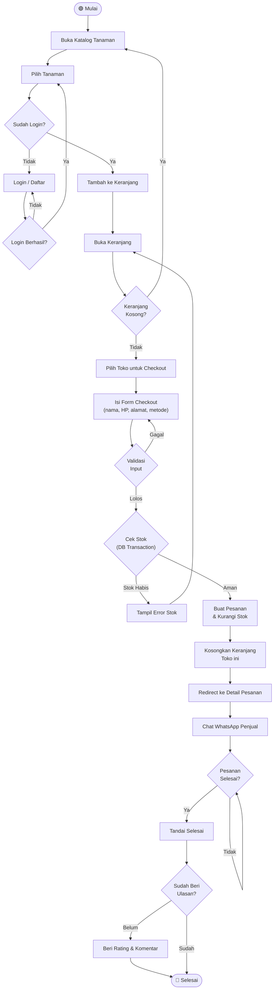

---

## 3. Activity Diagram — Pendaftaran & Verifikasi Email

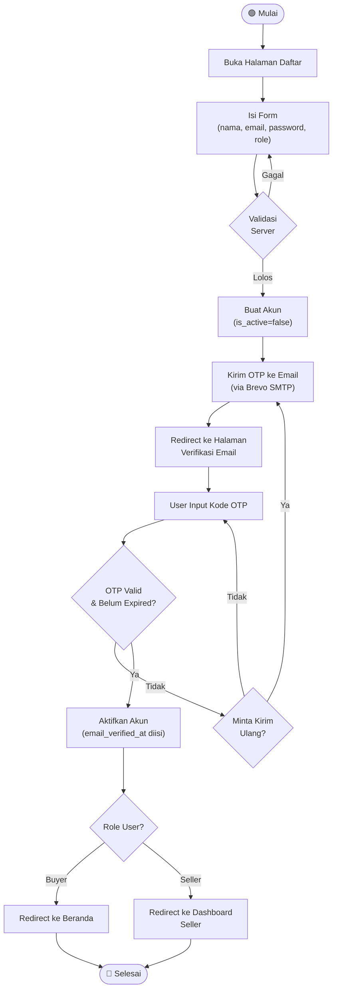

---

## 4. Activity Diagram — Proses Persetujuan Toko (Admin)

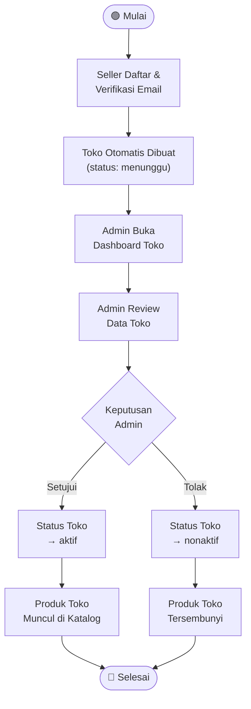

---

## 5. Sequence Diagram — Login

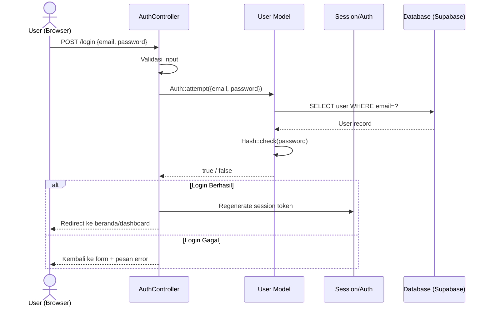

---

## 6. Sequence Diagram — Proses Checkout

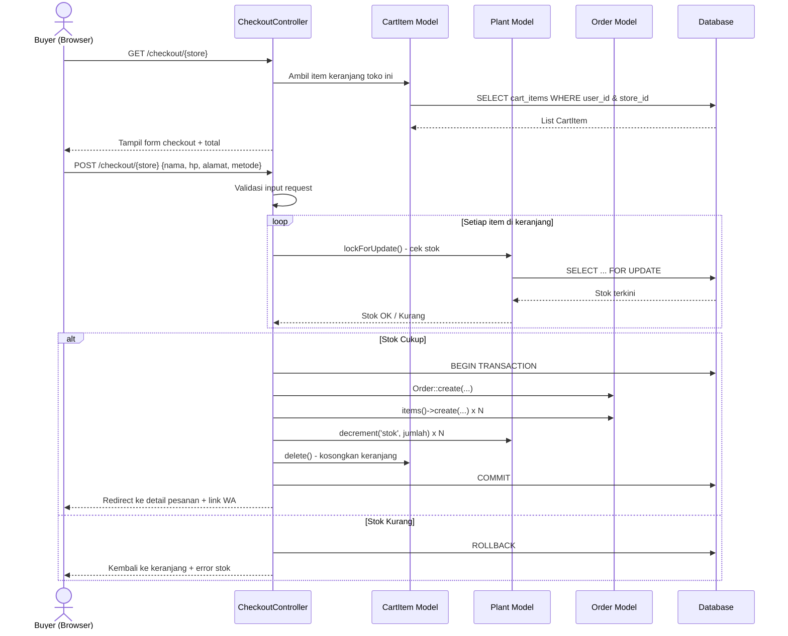

---

## 7. Sequence Diagram — Reset Password (3 Langkah)

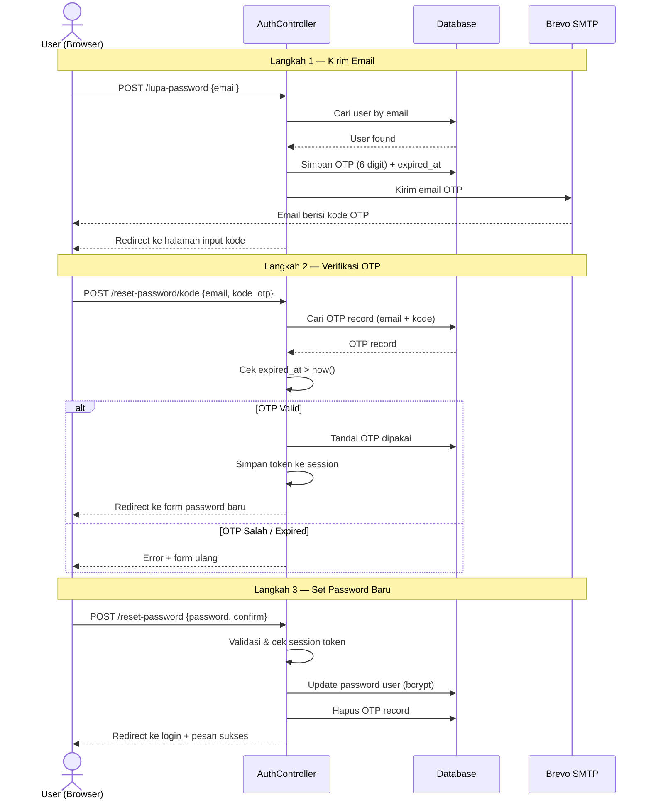

---

## 8. Entity Relationship Diagram (ERD)

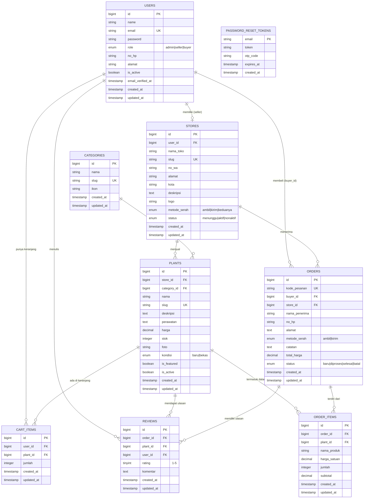

---

## 9. Class Diagram

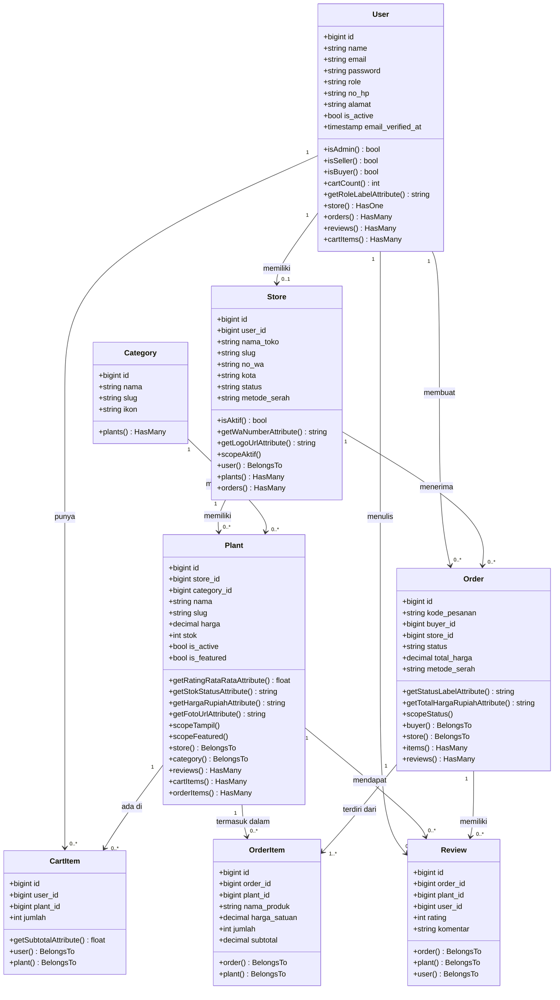

---

## 10. System Architecture Diagram

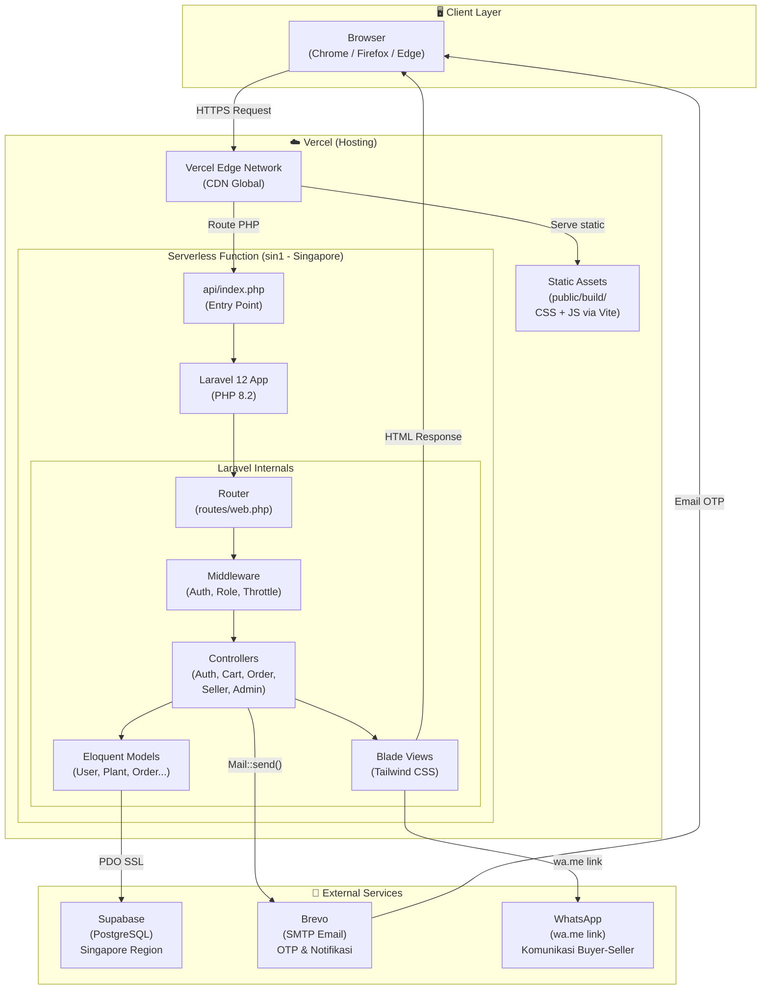

---

## 11. Deployment Diagram

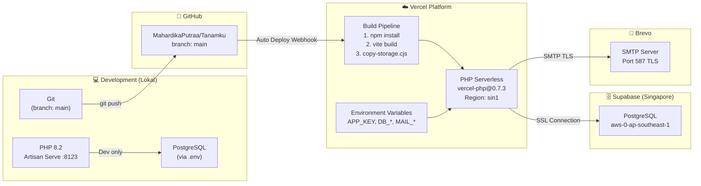

---

## 12. Component Diagram

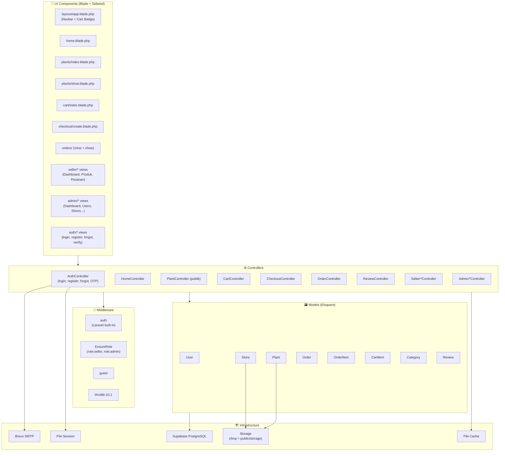

---

## 13. State Diagram — Status Pesanan (Order)

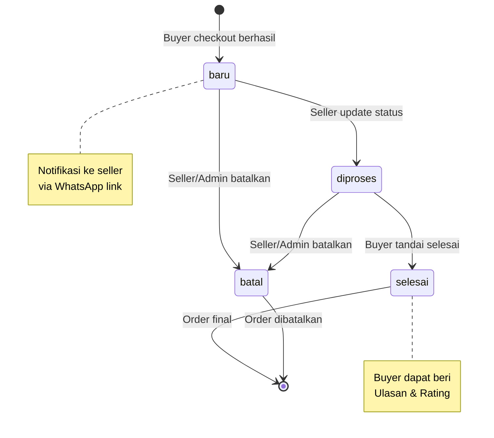

---

## 14. State Diagram — Status Toko (Store)

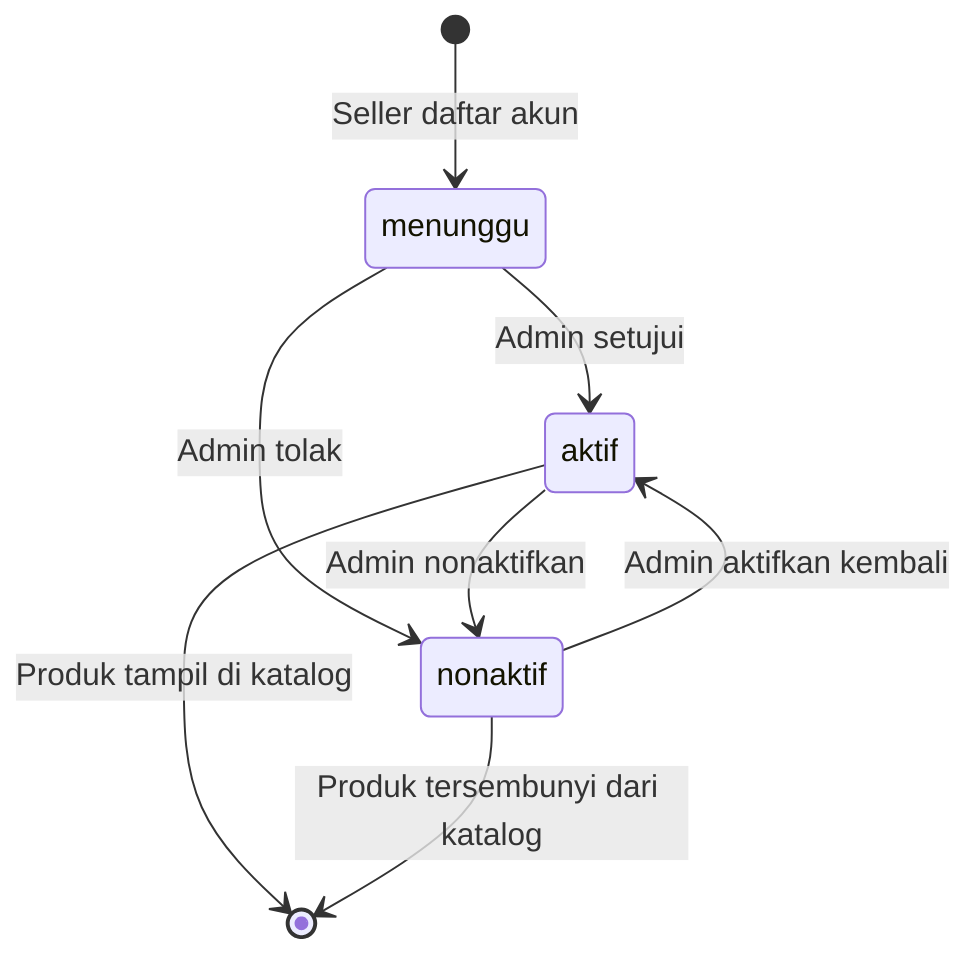

---

## 15. Data Flow Diagram (DFD) — Level 0 (Context Diagram)

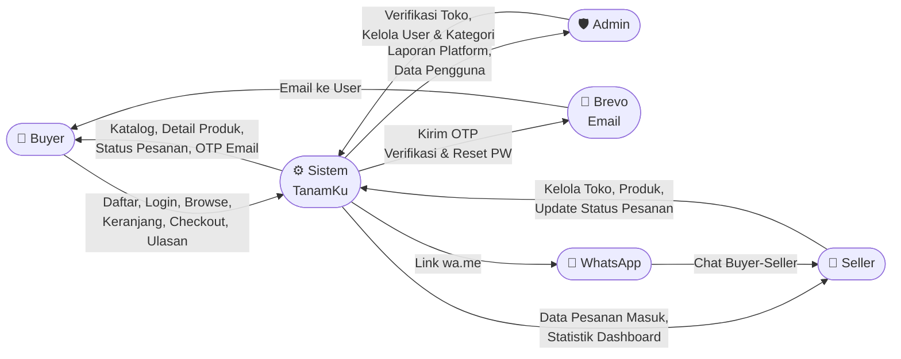

---

## 16. Data Flow Diagram (DFD) — Level 1

```mermaid
flowchart TD
    subgraph EXT["Entitas Eksternal"]
        B(["Buyer"])
        S(["Seller"])
        A(["Admin"])
        Email(["Brevo SMTP"])
    end

    subgraph PROC["Proses"]
        P1["1.0\nAutentikasi\n& Registrasi"]
        P2["2.0\nKatalog &\nPencarian"]
        P3["3.0\nKeranjang\nBelanja"]
        P4["4.0\nCheckout &\nPemesanan"]
        P5["5.0\nKelola Toko\n& Produk"]
        P6["6.0\nManajemen\nPlatform (Admin)"]
        P7["7.0\nUlasan &\nRating"]
    end

    subgraph STORE["Data Store"]
        DS1[("users")]
        DS2[("stores")]
        DS3[("plants")]
        DS4[("orders\n+ order_items")]
        DS5[("cart_items")]
        DS6[("reviews")]
        DS7[("categories")]
        DS8[("password_reset_tokens")]
    end

    B -->|"Kredensial"| P1
    S -->|"Kredensial"| P1
    A -->|"Kredensial"| P1
    P1 <-->|"R/W"| DS1
    P1 <-->|"R/W"| DS8
    P1 -->|"OTP Email"| Email
    Email -->|"Konfirmasi"| B

    B -->|"Query / Filter"| P2
    P2 -->|"Baca"| DS3
    P2 -->|"Baca"| DS2
    P2 -->|"Baca"| DS7
    P2 -->|"Hasil Pencarian"| B

    B -->|"Tambah/Edit/Hapus item"| P3
    P3 <-->|"R/W"| DS5
    P3 -->|"Data Keranjang"| B

    B -->|"Data Checkout"| P4
    P4 -->|"Baca"| DS5
    P4 <-->|"R/W"| DS4
    P4 -->|"Kurangi Stok"| DS3
    P4 -->|"Konfirmasi Pesanan"| B

    S -->|"Data Toko & Produk"| P5
    P5 <-->|"R/W"| DS2
    P5 <-->|"R/W"| DS3
    P5 -->|"Dashboard Seller"| S

    A -->|"Aksi Admin"| P6
    P6 <-->|"R/W"| DS1
    P6 <-->|"R/W"| DS2
    P6 <-->|"R/W"| DS3
    P6 <-->|"R/W"| DS7
    P6 -->|"Laporan"| A

    B -->|"Rating & Komentar"| P7
    P7 -->|"Baca"| DS4
    P7 <-->|"R/W"| DS6
    P7 -->|"Ulasan tersimpan"| B
```

---

## 17. Flowchart — Alur Kelola Produk (Seller)

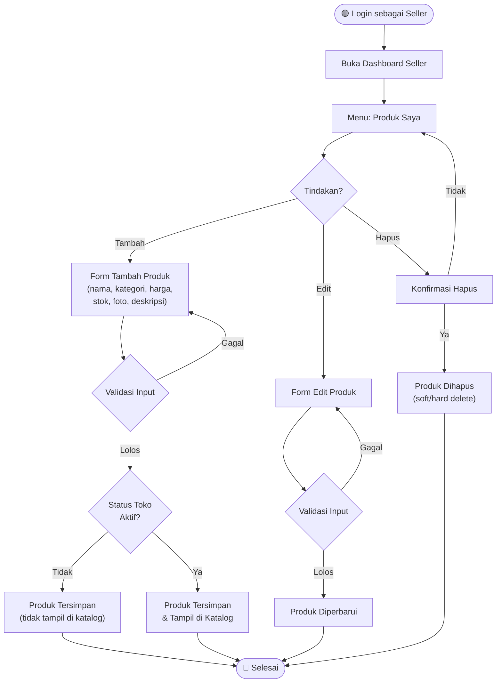

---

## 18. Wireframe / UI Flow

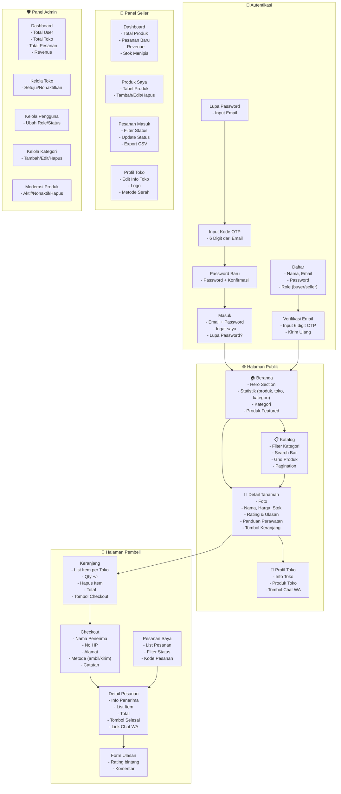

---

## 19. Diagram Pengujian (Test Coverage Map)

```mermaid
flowchart TD
    subgraph TEST_AUTH["🔐 Auth Tests"]
        T1["✅ Guest dapat akses halaman login"]
        T2["✅ Login dengan kredensial valid"]
        T3["✅ Login gagal dengan password salah"]
        T4["✅ Registrasi buyer/seller berhasil"]
        T5["✅ Redirect ke verifikasi email setelah daftar"]
        T6["✅ Email OTP terkirim saat verifikasi"]
        T7["✅ Forgot password — kirim OTP email"]
        T8["✅ Reset password dengan OTP valid"]
        T9["✅ Logout menghapus session"]
    end

    subgraph TEST_MARKET["🛒 Marketplace Tests"]
        T10["✅ Katalog tampil produk aktif toko aktif"]
        T11["✅ Detail tanaman dapat diakses publik"]
        T12["✅ Buyer tambah item ke keranjang"]
        T13["✅ Buyer checkout — pesanan terbuat"]
        T14["✅ Stok berkurang setelah checkout"]
        T15["✅ Checkout gagal jika stok tidak cukup"]
        T16["✅ Buyer tandai pesanan selesai"]
        T17["✅ Buyer beri ulasan setelah selesai"]
    end

    subgraph TEST_SELLER["🏪 Seller Tests"]
        T18["✅ Seller CRUD produk (tambah/edit/hapus)"]
        T19["✅ Seller update status pesanan"]
        T20["✅ Seller export CSV pesanan"]
    end

    subgraph TEST_ADMIN["🛡️ Admin Tests"]
        T21["✅ Admin setujui / nonaktifkan toko"]
        T22["✅ Admin kelola kategori"]
        T23["✅ Admin kelola user (role & status)"]
    end

    subgraph TEST_SECURITY["🔒 Security Tests"]
        T24["✅ Guest tidak bisa akses checkout"]
        T25["✅ Seller tidak bisa akses panel admin"]
        T26["✅ Buyer tidak bisa akses panel seller"]
        T27["✅ CSRF token pada semua form POST"]
        T28["✅ Throttle login (max 10/menit)"]
        T29["✅ Race condition checkout (DB lock)"]
        T30["✅ Seller hanya edit produk milik sendiri"]
    end

    TEST_AUTH --> TEST_MARKET
    TEST_MARKET --> TEST_SELLER
    TEST_SELLER --> TEST_ADMIN
    TEST_ADMIN --> TEST_SECURITY
```

---

## Ringkasan Diagram

| No | Diagram | Tujuan | Prioritas |
|----|---------|--------|-----------|
| 1 | Use Case Diagram | Gambaran semua fitur per aktor | ⭐ UTS |
| 2-4 | Activity Diagram | Alur proses utama sistem | ⭐ UTS |
| 5-7 | Sequence Diagram | Interaksi antar komponen | ⭐ UTS |
| 8 | ERD | Struktur database | ⭐ UTS |
| 9 | Class Diagram | Relasi antar model/class | ⭐ UTS |
| 10 | System Architecture | Gambaran teknis sistem | ⭐ UTS |
| 11 | Deployment Diagram | Infrastruktur hosting | 🔧 Dev |
| 12 | Component Diagram | Komponen & dependensi | 🔧 Dev |
| 13-14 | State Diagram | Siklus hidup Order & Store | ⭐ UTS |
| 15-16 | DFD Level 0 & 1 | Aliran data sistem | ⭐ UTS |
| 17 | Flowchart | Alur logika spesifik | 🔧 Dev |
| 18 | Wireframe / UI Flow | Navigasi antar halaman | 🔧 Dev |
| 19 | Diagram Pengujian | Peta test coverage | 🔧 Dev |
